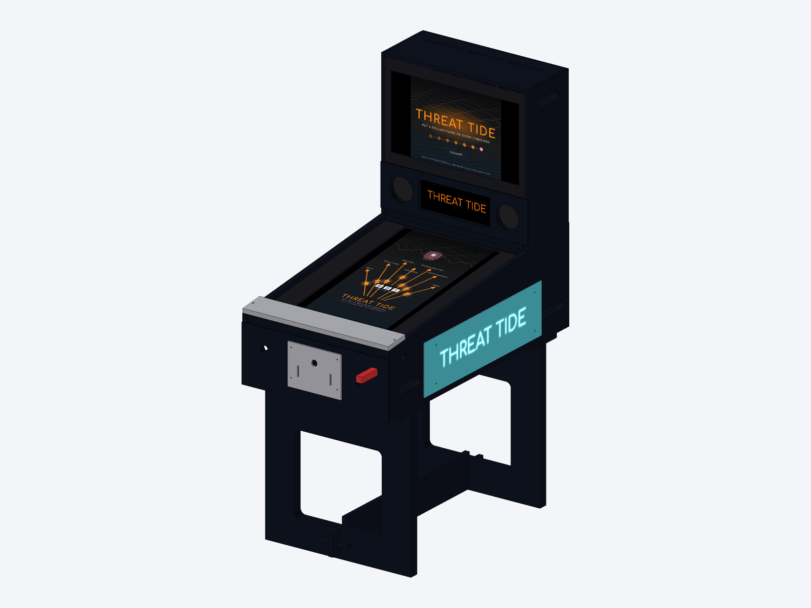
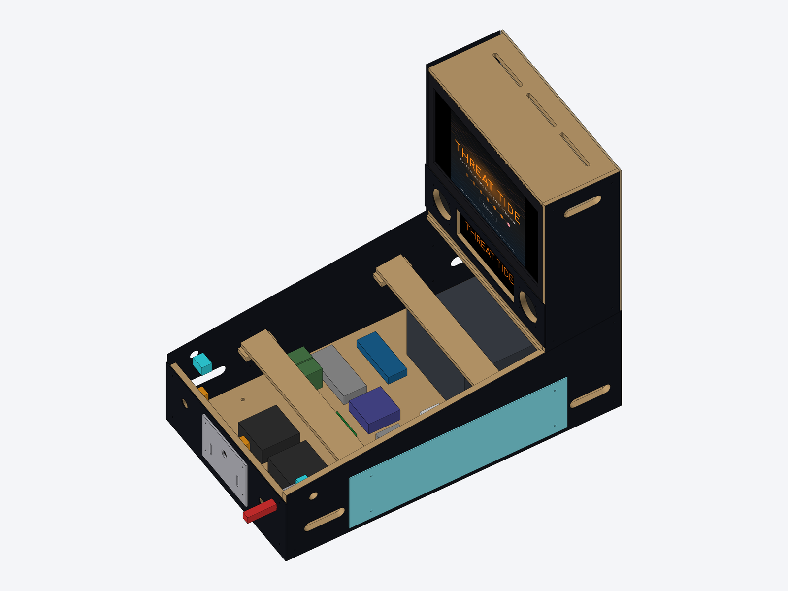
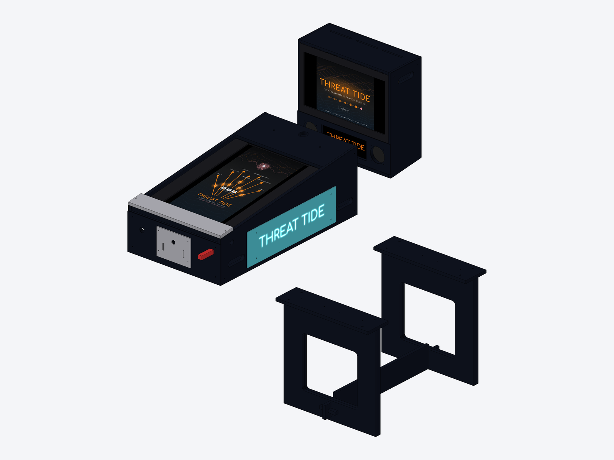
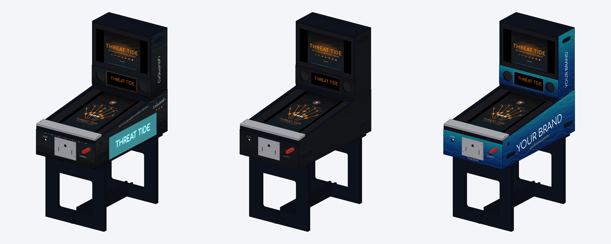

# Threat Tide cabinet

A wooden virtual-pinball cabinet built around the Threat Tide table. It has a 32" playfield monitor, a 24" backglass and a 12.3" DMD bar. It is cut from 18 mm plywood on a CNC and comes apart into three pieces that fit in a van or ute.



| | |
| --- | --- |
|  |  |

## Key numbers

| | |
| --- | --- |
| Footprint | 600 W x 1060 D mm (plus the plunger knob) |
| Height | 1572 mm to the backbox top; lockbar at 911 mm |
| Playfield | 32" 16:9 monitor in portrait under 5 mm toughened glass, 6.5 degree slope built into the sides |
| Backbox | 24" monitor (backglass), 12.3" 1920 x 720 bar LCD (DMD), two 4" speakers |
| Feel | Real plunger, nudge sensing (Pinscape Pico accelerometer), flipper contactors, two bass shakers |
| Look | Lockbar, coin-door plate with Exit button, edge-lit acrylic side panels, LED trim |
| Material | 2 sheets 18 mm plywood, 6 mm plywood offcut, 6 mm MDF offcut, 3 mm acrylic, glass cut by a glazier |

## Transport

The cabinet breaks down into three modules, with no tools needed for the legs:

| Module | Size (mm) | Weight, wood only | Weight, fitted out | Carry |
| --- | --- | --- | --- | --- |
| Body (with the playfield monitor and PC inside) | 630 x 1075 x 381 | 31 kg | ~44 kg | 2 people, hand slots at each end |
| Backbox | 606 x 245 x 586 | 11 kg | ~17 kg | 1 person, slots in the sides |
| Legs (2 frames + stretcher) | each frame 600 x 608 x 36 | 14 kg | 14 kg | 1 person |

Weights are estimates and include the vinyl skins. Breakdown and setup take about 10 minutes each; see [BUILD.md](BUILD.md#transport).

## Vinyl skins and liveries

The outside is covered by removable printed vinyl on 3 mm ACM (aluminium composite) panels: body sides, front, backbox sides, and the speaker panel. Swapping a livery takes about 15 minutes and needs no repainting. That is what makes the rental options work: the generic box, the client's own vinyl, or the Threat Tide look for your own shows.



| Folder | What |
| --- | --- |
| `out/skins/threattide/` | CyQuantiFi / Threat Tide livery, print-ready PDF per panel |
| `out/skins/generic/` | Neutral satin black, no branding ("generic box") |
| `out/skins/vendor-demo/` | Example client reskin, to show vendors what they get |
| `out/skins/template/` | Guide sheets (PDF + SVG) for a client's designer: trim, 5 mm bleed, 10 mm safe zone, cut-outs, and the light-panel zone |

Every file is 1:1 in mm, seen from the outside, with 5 mm bleed. Send the PDF plus the matching cut file (`out/dxf/P30` to `P35`) to a sign shop. They print, laminate, apply to ACM and route it, or you route the ACM on your CNC. Regenerate with `python3 cabinet/make_skins.py`; the logo is a text placeholder until there's a real logo file.

For a client reskin, either their designer works on the template, or you swap the colours and words in `LIVERIES` at the top of `make_skins.py`.

## Files

| File | What |
| --- | --- |
| [`BOM.md`](BOM.md) | What to buy, where (Bunnings, RS, Core Electronics, Jaycar, PB Tech), and roughly what it costs |
| [`BUILD.md`](BUILD.md) | Cutting, assembly, wiring, finishing, transport |
| [`out/drawings.pdf`](out/drawings.pdf) | A3 drawings: overview, general arrangement at 1:10, every part dimensioned, sheet layouts |
| `out/sheets/*.dxf` | **What the CNC cuts**: parts nested on 2400 x 1200 sheets (acrylic on 1200 x 600) |
| `out/dxf/P##_*.dxf` | One DXF per part, in case you want to nest them yourself |
| [`out/cutlist.csv`](out/cutlist.csv) | Part list: size, quantity, material, weight |
| `out/cabinet.glb` | 3D model with all parts and the bought components (opens in Windows 3D Viewer, Blender, gltf-viewer.donmccurdy.com) |
| `out/stl/*.stl` | One mesh per transport module (for Fusion 360 / SketchUp mesh import) |
| `geometry.py` | The design: every number and every part |
| `make_cabinet.py` | Turns `geometry.py` into all of the above |
| `make_skins.py` | Vinyl print files, templates and livery renders |

### DXF layers

| Layer | Operation |
| --- | --- |
| `CUT_OUTSIDE` | Profile cut outside the line, full depth (use tabs) |
| `CUT_INSIDE` | Profile cut inside the line, full depth (holes, windows, slots) |
| `DRILL` | Drill or helical bore at the circle size, full depth |
| `POCKET_6` | Pocket 6 mm deep from the top face (dados and rebates) |
| `POCKET_6_BACK` | Pocket 6 mm deep from the **other** face: flip the part. Only P21 (backbox top) and P22 (speaker panel) have one |
| `ENGRAVE` | V-carve or engrave about 0.5 mm deep: side panel text, coin-door text |
| `MARK` | Layout lines (cleat positions). Engrave 0.3 mm or ignore and measure |
| `NOTES` | Labels only, do not cut |

Each part is drawn as seen from the face that is up on the CNC bed (the face with the pockets). Right-hand parts are mirror images of the left ones and are drawn that way.

## Changing the design

Every dimension is in `P` at the top of [`geometry.py`](geometry.py). **Before cutting, measure your actual plywood thickness and your monitors**, then set them there:

| Parameter | What to measure |
| --- | --- |
| `T` | Your 18 mm plywood. It is often 17.4 to 18.2 mm. Dados follow it automatically |
| `TV`, `TV_VIEW` | 32" monitor outside size and depth without its stand, and the visible picture area (the mask window) |
| `MON`, `MON_VIEW` | Same for the 24" backglass monitor |
| `DMD`, `DMD_VIEW` | The bar LCD's outline and active area |
| `LEG_TOP` | Floor height. 633 puts the lockbar at about 911 mm, normal for pinball |

Then regenerate:

```
pip install -r cabinet/requirements.txt
python3 cabinet/make_cabinet.py --check   # seconds: clearance check + nesting
python3 cabinet/make_cabinet.py           # about 3 minutes: every output
```

The clearance check samples every part and every bought component (monitors, PC, plunger, buttons, contactors, supplies, speakers, and room for hands in the carry slots). It fails if any two overlap, so a change that makes something not fit is caught before you cut. CI runs it on every push.
